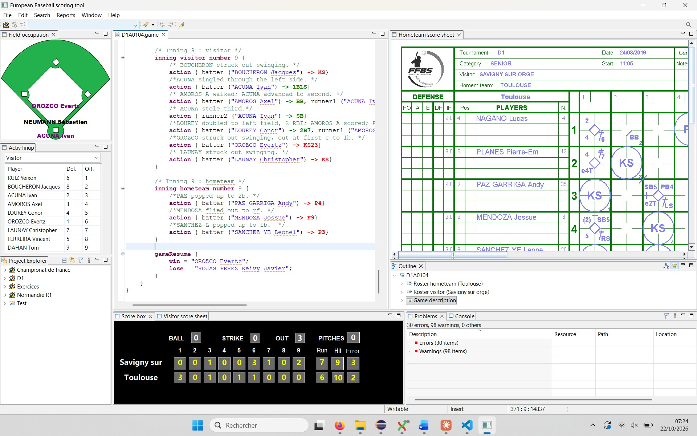

# European Baseball scoresheet tool

Vous pouvez trouver la version anglaisee de ce document [ici](README.md)

Il existe aujourd'hui de nombreuses solutions informatiques permettant de saisir et d'éditer des feuilles de scorage de baseball. Toutefois, ces outils sont principalement conçus selon les pratiques américaines et ne répondent pas nécessairement aux spécificités du scorage européen.

Le scorage européen possède ses propres règles et conventions de notation, qu'il est important de respecter pour garantir la conformité des feuilles de match et la cohérence des statistiques produites.

**Ce projet a pour objectif de proposer une solution informatique adaptée au scorage européen**, permettant de saisir, de gérer et d'éditer des feuilles de score conformément aux pratiques européennes.
Il vise ainsi à mettre à la disposition des scoreurs, des clubs et des personnes impliquées dans le baseball européen un outil répondant à leurs besoins spécifiques.

## Présentation du logiciel
Cette application est basée sur un langage qui permet de décrire les différentes actions d’un match de baseball en utilisant un langage dédié. Pour cela l’application permet d’éditer la composition des clubs engagés dans un championnat et d’un deuxième éditeur permettant de décrire toutes les actions dans un match.  Cette application se présente sous la forme suivante :

Cette application contient plusieurs vues dont principalement :
-	La zone d’édition
-	Une fenêtre permettant de voir des erreurs ou avertissements les informations saisies
-	Une vue de l’infield avec le nom et position des joueurs
-	Le line up actif
-	Un gestionnaire de projet
-	Un tableau d’affichage
-	Une vue graphique (en temps réel de la feuille de scorage)

Lorsque le match est saisi, il est ensuite possible d’exporter les feuilles de scorage au format PDF.
L’utilisation de ce logiciel est décrite dans l’aide qui est accessible via le menu « Aide ». Cette aide comprend le manuel utilisateur de l’application et le manuel de scorage rédigé par Anna Maria PAINI. 

L‘application vous permet aussi d’importer le championnat de D1 2019 qui sera une aide pour comprendre le fonctionnement de cette application.

## Installation/ Utilisation

Ce logiciel est livré sous la forme d’un fichier ZIP que vous devrez dézipper dans un répertoire de votre choix. Pour lancer l’application, vous pourrez créer un raccourci sur bureau pointant sur le fichier EuropeanScoreTool.exe

## Compilation pour les développeurs
Si vous souhaitez reconstruire cette application, vous devez utiliser maven. Cette construction se fait en deux étapes :
-	Dans le projet org.bpy.socre.build , faite un run->run as->maven install sur le fichier pom.xml
-	Dans le projet org.bpy.score.project , faite un run->run as->maven install sur le fichier pom.xml
-	L’application sera alors disponible dans le répertoire target sous la forme d’un fichier zip dans le répertoire org.bpy.score.product\target\products. Le nom de ce fichier est sous la forme  ScoreKepperTool_x.x.x-SNAPSHOT.zip

## Technologies utilisées
Voici les principaux outils utilisés

| outil | Description |   
| :----- | :----- |
|Java	 | Java 17|
|Edition | 	Eclipse 2023-06 développeur DSL|
|Build	 | Maven|

Liste des plugins utilisés sous eclipse.

| Technologie | Description |   
| :----- | :----- |
|WindowBuilder|	Edition des interfaces graphiques
|Sonarlint|	Analyse de la qualité du code|
|XText|	Définition des deux éditeurs|
|Git|	Gestion de configuration|

Langages utilisés. 

| Technologie | Description |   
| :----- | :----- |
|Java|	Code de l’application|
|Xtend|	Tests unitaires|
|XText	Description du langage des éditeurs|
|Markdown|	Cette documentation|
|Html|	Aide sur l’application|
|XML|	Fichiers de description des projets|

## Licence
Ce logiciel est sous License GPL-3.0. cela signifie que vous pouvez l’utiliser librement, récupérer les sources pour apporter des améliorations (ce serait sympa de m’en faire profiter) , mais par contre, vous interdit d’en faire un usage commercial sans mon autorisation.

## Limitations
Ce logiciel est toujours en cours de développement, il y a donc des limitations dans son utilisation.
-	La génération de rapports n’est pas encore complète.
-	Le logiciel ne prend pas en compte les changements spécifiques au softball.
-	Le logiciel ne gère pas la feuille supplémentaire lorsqu’il y a eu plus de 12 manches ou trop de changements.
-	Il existe quelques problèmes qui ne sont pas encore résolus. 

## Contact ou auteur.
Si vous souhaitez me signaler des disfonctionnements, vous avez deux solutions :
-	Ouvrir une issue sous github en me décrivant le plus explicitement le problème rencontré.
-	Ou m’envoyé un mail à briand.patrick arrobase free.fr

## Versions.
